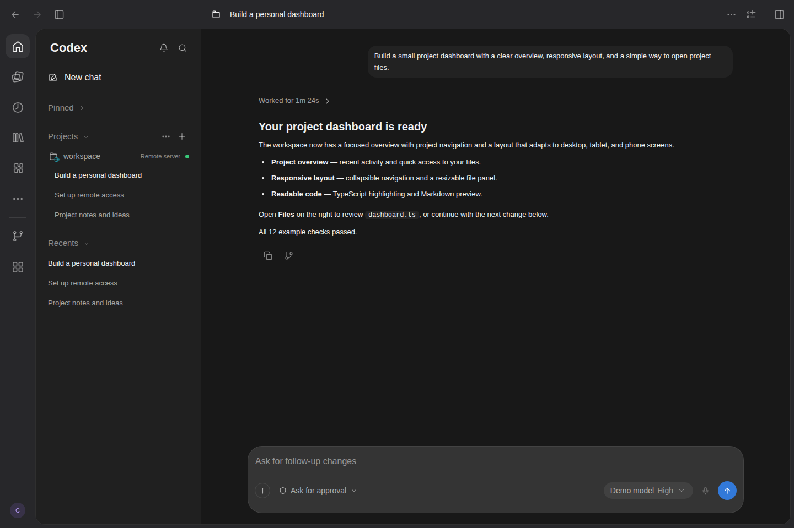
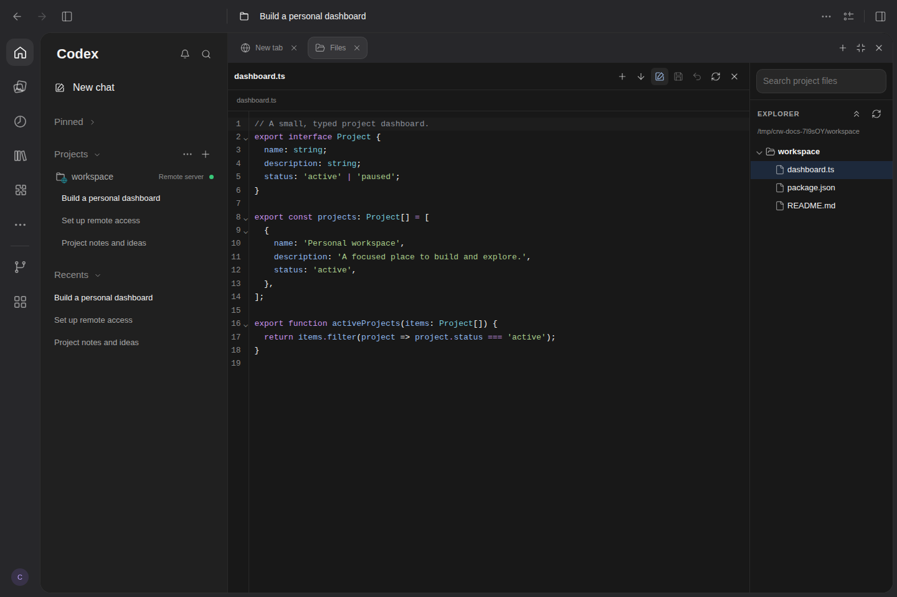
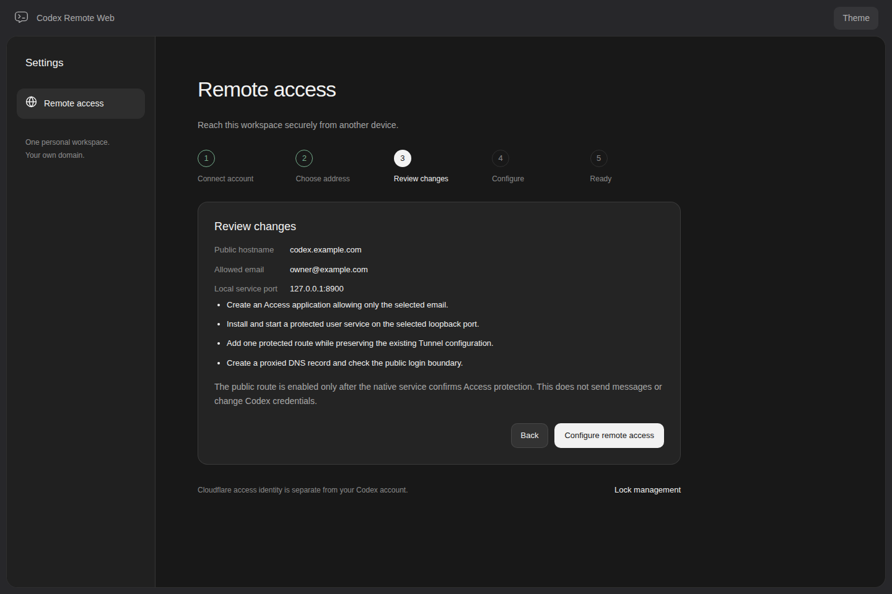
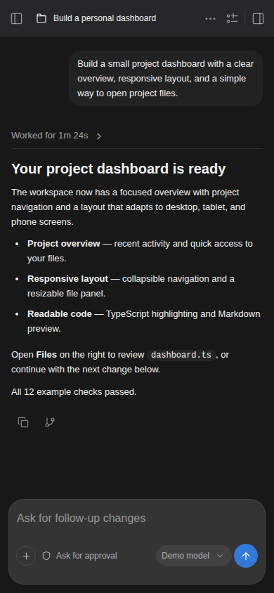
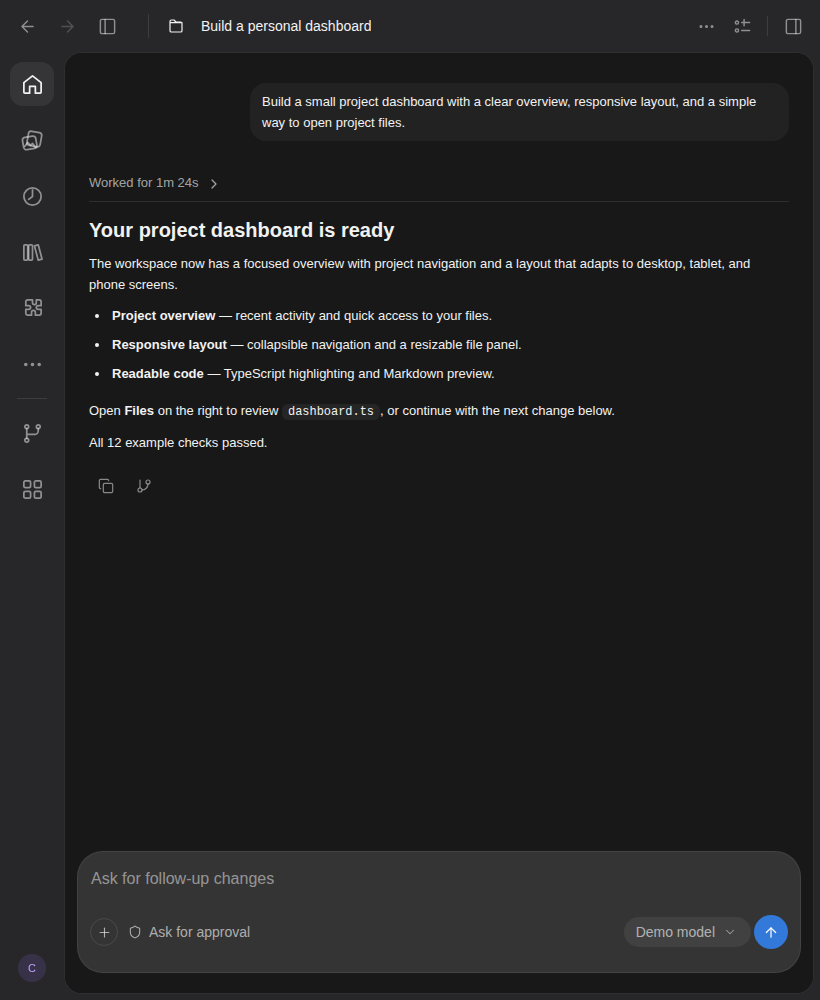
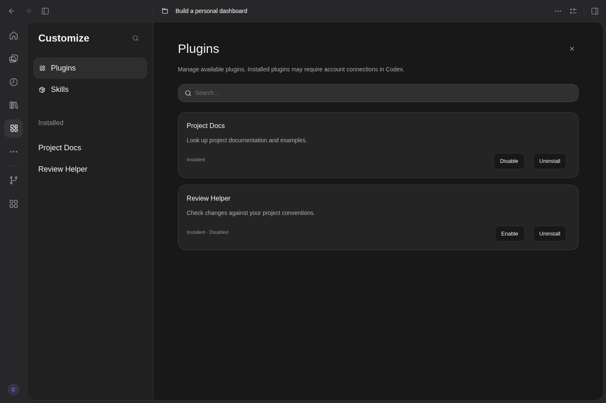

# Codex Remote Web

[English](README.md) | **简体中文**

**把本机 Codex 工作区连接到公网，在电脑、平板和手机上继续开发。**

使用 **Cloudflare Tunnel + Access** 的自托管浏览器工作区：通过网页配置远程访问，在其他设备上继续会话、查看工具进度、处理审批和编辑项目文件。

> **Beta.1 候选说明：** 当前分支准备 **0.2.0-beta.1**，包含桌面网关及新的会话默认行为。已发布的 **0.2.0-alpha.3** 安装包仍通过终端启动；下文新功能请使用 Beta.1 构建。详见 [Beta.1 发布说明](docs/releases/0.2.0-beta.1.md)。

## 项目亮点

- **公网接入，全程网页配置。** 连接 Cloudflare 账户、选择域名与 Tunnel、指定允许登录的邮箱，预览后部署；无需直接暴露 WebUI 端口。
- **没有域名也能用。** 启动受邮箱验证码保护的临时 HTTPS 地址，复制链接或扫码访问，无需 Cloudflare 账户或 API Token。
- **桌面管理，浏览器访问。** macOS、Windows 和 Linux 通过托盘与设置页面初始化、控制后台网关；桌面和 Web 设置采用协调的主题与控件，动效遵循系统的减少动态效果偏好。
- **跨设备继续工作。** 桌面、平板和手机布局，中英文界面、深浅主题、可调整大小的双侧栏和右面板最大化。
- **继续同一原生会话。** 默认连接 Codex Desktop/CLI 的共享 App Server，服务尚未就绪时等待连接；支持流式输出、运行进度、审批、原生临时 Side chat 和 Fork。
- **浏览器里的开发工具。** 文件树、语法高亮、代码编辑、Markdown 预览编辑、附件、插件与技能管理，以及项目指令和工作树管理。
- **发送有反馈，排队可恢复。** 支持运行中追加指令或排队，服务端持久队列、多页面同步和提交结果核对；结果不明时暂停，避免自动重复执行。

## 页面预览

以下为当前 WebUI 的实际页面截图，使用隔离的演示项目和模拟会话数据，展示界面与布局；不是模型执行或真实 Cloudflare 部署的结果。

**桌面工作区 · 会话、项目导航与模型/权限选择**



<table>
  <tr>
    <td width="50%"><strong>Files · 文件树、语法高亮与代码编辑</strong></td>
    <td width="50%"><strong>Cloudflare · 公网接入配置预览</strong></td>
  </tr>
  <tr>
    <td></td>
    <td></td>
  </tr>
</table>

<table>
  <tr>
    <td width="35%"><strong>手机 · 随时继续会话</strong></td>
    <td width="65%"><strong>平板 · 更宽的阅读与操作空间</strong></td>
  </tr>
  <tr>
    <td align="center"></td>
    <td align="center"></td>
  </tr>
</table>

<details>
<summary>查看 Customize 插件与技能管理界面</summary>



</details>

## 桌面网关

macOS DMG、Windows MSI 和 Linux 桌面 DEB 提供统一的初始化与设置窗口，管理后台网关、登录自启、公网连接与诊断。关闭窗口或退出托盘后网关继续运行，注销后停止；启动网关无需终端。CLI 便携包继续提供服务器/命令行运行方式。详见[桌面平台说明](docs/deployment/PLATFORMS.md)。

## 快速开始

### 下载桌面安装包或可执行包（推荐）

从 [Releases](https://github.com/danvilig/codex-remote-web/releases) 下载系统对应的归档和同名 `.sha256`。包内含可执行程序、Bun/Node、网页资源和原生终端模块，**无需安装运行时或现场编译**，请保留解压后的完整目录。仍需自行配置 Codex CLI、Git；公网访问需要 cloudflared。

| 系统 | 包名后缀 | 要求 |
| --- | --- | --- |
| Linux x64 / arm64 | `desktop-linux-x64.deb` / `desktop-linux-arm64.deb`（桌面）；`linux-x64.tar.gz` / `linux-arm64.tar.gz`（CLI） | glibc；桌面基线为 Ubuntu 24.04 GNOME |
| macOS Apple Silicon | `macos-arm64.dmg`（安装）/ `.tar.gz`（便携） | macOS 15 或更新；不支持 Intel Mac |
| Windows x64 | `windows-x64.msi`（安装）/ `.zip`（便携） | Windows 11、NTFS、Windows PowerShell；不支持 ARM64 |

### 桌面安装包：初始化后通过托盘管理

macOS 将 DMG 中的 **Codex Remote Web.app** 拖入 Applications 后打开。Windows 安装当前用户 MSI，从开始菜单启动 **Codex Remote Web**。Ubuntu 安装桌面 DEB 后，从应用菜单打开。

1. 在**网关设置**选择项目目录和端口（默认 `8899`）；未自动找到程序时选择 Codex/cloudflared 路径，检测依赖并保存。沿用你现有的 Codex 账户与配置。
2. 在**概览**启动网关并打开浏览器工作区；设置窗口可启动、停止和重启，托盘菜单可启动和停止。
3. 需要其他设备访问时，进入**远程访问**，选择固定域名或受邮箱验证码保护的临时地址。

关闭设置窗口后隐藏到托盘，退出托盘后后台网关继续运行。Linux 桌面不支持托盘时，关闭设置会最小化到任务栏。点击**停止网关**会停止网关和自有连接，注销登录也会结束后台会话。**登录时启动网关**默认勾选，首次保存设置时注册；不需要时请在保存前取消勾选，之后关闭此选项不会停止当前网关。网页终端默认关闭。

升级前先停止网关。Windows 可从**已安装的应用**卸载，Linux 可移除 DEB；macOS 删除应用前，先在**诊断 → 停止并移除后台组件**清理。项目和 Codex 凭据保留，移除托管 Cloudflare 部署需另在远程访问中操作。详见[桌面平台说明](docs/deployment/PLATFORMS.md)。

桌面包暂未签名；核对校验和及源码，仅对可信下载使用系统的单文件批准，不要全局关闭 Gatekeeper 或 SmartScreen。不支持 Linux 32 位 ARM 和 Alpine/musl。

### CLI 便携包

以下示例针对 **0.2.0-beta.1** 便携包，请按实际下载选择对应的包名与版本；正式发布前，候选包位于 CI Artifact。通过终端运行时，关闭终端或按 Ctrl+C 停止网关。
```sh
archive=codex-remote-web-0.2.0-beta.1-linux-x64.tar.gz
# arm64 改为 codex-remote-web-0.2.0-beta.1-linux-arm64.tar.gz
sha256sum -c "$archive.sha256"
tar -xzf "$archive"
cd codex-remote-web-0.2.0-beta.1
CODEX_WEBUI_CWD=/path/to/your/project ./codex-remote-web
```

访问 `http://127.0.0.1:8899` 打开完整 WebUI，再进入设置 → Remote access 配置公网。`./codex-remote-web setup` 只打开独立配置向导；支持 `--help` 和 `--version`。

macOS 解压 `macos-arm64` 后使用同样的启动方式。Windows 解压 zip，在目录内打开 PowerShell：

```powershell
# 解压前将输出与同名 .sha256 内容核对。
Get-FileHash .\codex-remote-web-0.2.0-beta.1-windows-x64.zip -Algorithm SHA256
$env:CODEX_WEBUI_CWD = 'C:\path\to\your\project'
.\codex-remote-web.exe
```

### 从源码或部署归档运行

需要 Bun **1.4.4**、Node.js **24.22.2**、Git 和已配置的 Codex CLI。当前验证协议版本为 Codex **0.164.0**。Linux 原生依赖还需要 C/C++ 构建工具和 Python 3。

Release 的 `deployment-linux-*` 归档包含已构建的 JS/静态资源和冻结锁文件，在目标机器安装生产依赖后运行 `bun run start`。GitHub 自动提供的 Source code 下载包含源码，需要执行以下构建。

```sh
bun install --frozen-lockfile
cp .env.example .env
# 编辑工作目录；沿用你自己的 Codex 配置和凭据。
bun run dev
```

访问 `http://127.0.0.1:8899`。`bun run start` 运行源码服务；生产使用 `bun run build` 后的 `bun run start:production`。程序资源根据安装位置定位，与启动命令所在目录无关。

WebUI 默认连接本机共享 App Server；socket 尚未就绪时等待，旧值 `auto` 也不会因启动顺序另起写入进程。请启动原生 daemon；没有共享服务的独立部署可显式设置 `CODEX_WEBUI_APP_SERVER_MODE=isolated`。两个独立进程不能同时写同一会话。参见[共享服务配置](docs/CONFIGURATION.md#与-codex-desktop--cli-共享会话)。

## 配置公网访问

桌面管理的网关请在桌面应用打开**远程访问**；浏览器设置显示部署状态并提示返回桌面管理。CLI/无桌面网关在完整本地 WebUI 打开 **设置 → 远程访问**。先初始化并启动本地网关，再根据是否拥有域名选择入口：

| 方式 | 固定域名访问 | 无域名临时访问 |
| --- | --- | --- |
| 地址 | 自己的域名或子域名 | 自动分配的临时 HTTPS 地址 |
| 登录保护 | Cloudflare Access，指定唯一邮箱 | 邮件验证码，指定唯一邮箱 |
| 前置条件 | Cloudflare 账户、已托管域名、API Token 和 cloudflared；由桌面应用或 Linux 用户级 systemd 管理 | 支持 `--allowed-mail` 的 cloudflared；可执行包已内置 Node.js |
| 配置入口 | 开始配置 → 选择 Tunnel 与域名 → 预览 → 应用 | 无域名临时访问 → 填写邮箱 → 启动 |
| 生命周期 | 桌面应用管理的后台网关/连接器，或 Linux 用户服务 | 随网关和连接器运行；停止后需重新生成地址 |

固定域名向导支持识别本机连接器、复用或新建 Tunnel、子域名及根域名 `@` 输入，以及后续域名、Tunnel 和邮箱调整。默认使用独立的 `127.0.0.1:8900` 受保护网关，保留本地工作区。macOS/Windows/Linux 由桌面应用管理该网关和连接器；无桌面的自动服务部署使用 Linux 用户级 systemd。

新建固定域名 Access 应用采用 **30 天（`720h`）应用会话**，Cookie 设置为 HttpOnly、SameSite=Lax。升级 WebUI 不会修改已有应用；管理员可按需另行调整云端设置。较短的策略/全局/客户端有效期、撤销、退出或清除 Cookie 都可能要求提前重新登录。此变化不影响临时地址的邮箱验证码认证。迁移说明见[Cloudflare 部署文档](docs/deployment/CLOUDFLARE.md)。

也可以仅启动配置网页，不启动 Codex App Server：

```sh
bun run setup:cloudflare
```

终端会输出带一次性凭证的本地链接。API Token 权限按 `Account → 权限组 → 级别` 和 `Zone → 权限组 → 级别` 三段式填写；完整步骤见[网页向导说明](docs/deployment/SETUP.md)。

## 工作区能力

| 模块 | 支持的操作 |
| --- | --- |
| 会话与运行 | 项目分组、置顶、搜索、通知排序，实时工具过程、运行状态、加载反馈、计划、审批与用户问题卡片 |
| 发送与队列 | 发送中反馈、steering/排队选择、持久回执、后台队列、编辑/重排/取消/暂停，多页面版本同步与断线核对 |
| Files | 跟随会话项目目录，按需展开文件树、搜索、相对路径、语法高亮、代码保存与冲突保护；Markdown 支持预览中按段落编辑及全文源码编辑 |
| 附件与图片 | 文件/文件夹上传、粘贴、拖放及服务器文件引用；Library 展示上传与会话分享的附件，Images 展示本机及上传图片 |
| Side chat | 原生临时分支，共用输入框样式，独立模型/推理/权限、附件与审批；可显式保存上下文到普通聊天 |
| Customize | 插件/技能启停、安装与卸载，可信本机技能目录安装 |
| Scheduled | 服务器后台单次/固定间隔任务，审批等待、暂停/停止与持久运行记录 |
| 项目工具 | 项目 AGENTS.md 编辑和预览、只读继承范围、托管工作树创建/移除、存储占比及受限清理预览 |
| 设置与连接 | 中英文、深浅主题、模型/推理偏好、受限原生配置、只读 MCP 状态/工具/资源清单，WebSocket 与 SSE 降级 |

## 部署与使用边界

桌面使用可选择 macOS/Windows 安装包或 Linux 桌面 DEB；服务器使用无桌面的 Linux 包或 Docker。桌面后台进程以登录用户运行，需要注销后仍在线时应使用服务器部署。桌面应用不会自动接管已有 headless/systemd 部署，切换前先停止冲突网关。

桌面管理的固定域名配置和受保护临时访问支持 macOS、Windows、Linux。无桌面的自动服务部署依赖 Linux 用户级 systemd；容器内不能通过向导配置宿主机 systemd，默认 Docker 镜像不包含 Codex 或 cloudflared。见[跨平台配置](docs/deployment/PLATFORMS.md)。

默认仅监听 loopback，公网通过受保护的 Tunnel 接入。Access 身份验证与 Codex 命令审批、Linux 权限和沙箱分别生效。

Sites 部署、图片生成、云端 Library、插件账户 OAuth 和完整 MCP 交互保留在后续路线图。更多限制见[发布说明](docs/releases/0.2.0-beta.1.md)。

### 共享 Codex 会话与独立部署

WebUI 不代为启动共享 daemon。请通过 Codex Desktop/CLI 启动兼容的 daemon；WebUI 会在服务就绪后重连，不自动重放执行请求。停止网关不会停止 daemon 或其中的任务。Docker 镜像和 Compose 已显式选择 `isolated` 模式。升级已有独立部署前，先核对任务、审批和队列，再重启网关以切换连接模式，仅刷新网页无效。

## 文档与开发

- [配置参考](docs/CONFIGURATION.md) / [Cloudflare 部署](docs/deployment/CLOUDFLARE.md)
- [开发与测试](DEVELOPMENT.md) / [贡献指南](CONTRIBUTING.md)
- [架构](docs/ARCHITECTURE.md) / [路线图](docs/ROADMAP.md)
- [发布流程](docs/RELEASING.md) / [候选验证记录](docs/releases/0.2.0-beta.1-acceptance.md) / [变更记录](CHANGELOG.md)
- [贡献规范](CONTRIBUTING.md) / [Git 开发流程](docs/GIT_WORKFLOW.md) / [AI agent 规则](AGENTS.md)
- [安全说明](SECURITY.md)

## 参考与致谢

本项目参考 [lezi-fun/codex-webui](https://github.com/lezi-fun/codex-webui) 的 MIT 许可代码与早期 WebUI 形态，当前独立维护；围绕 Cloudflare 公网接入重新设计认证、部署向导、状态协调与浏览器工作区。历史代码来源与许可署名予以保留，详见 [LICENSE](LICENSE) 和[第三方声明](THIRD_PARTY_NOTICES.md)。
