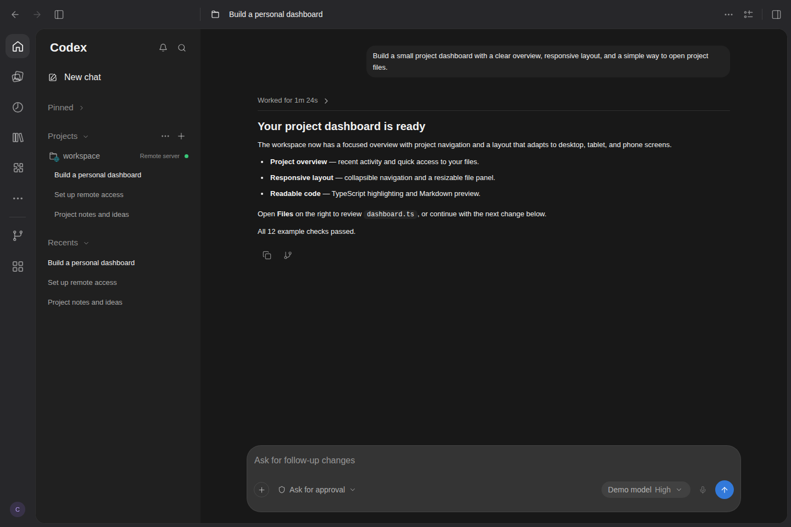
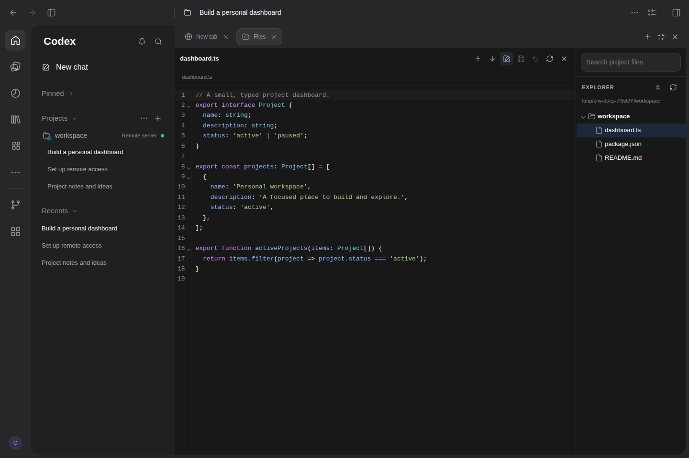
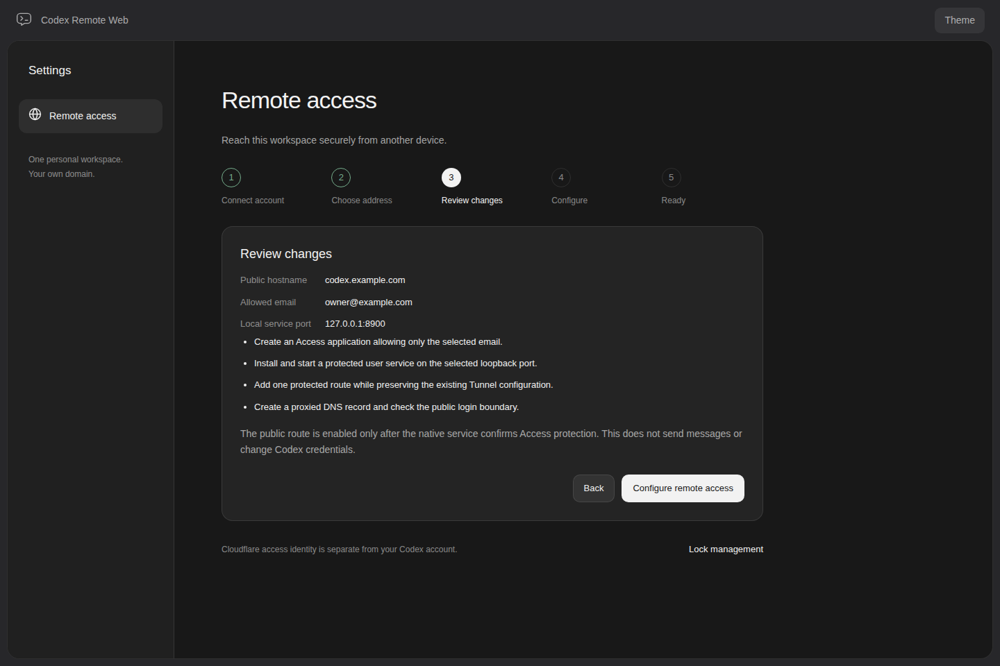
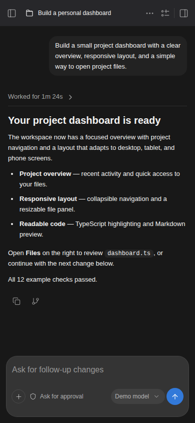
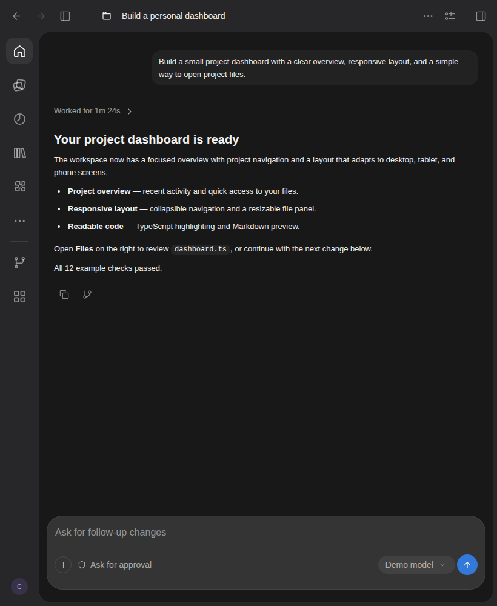
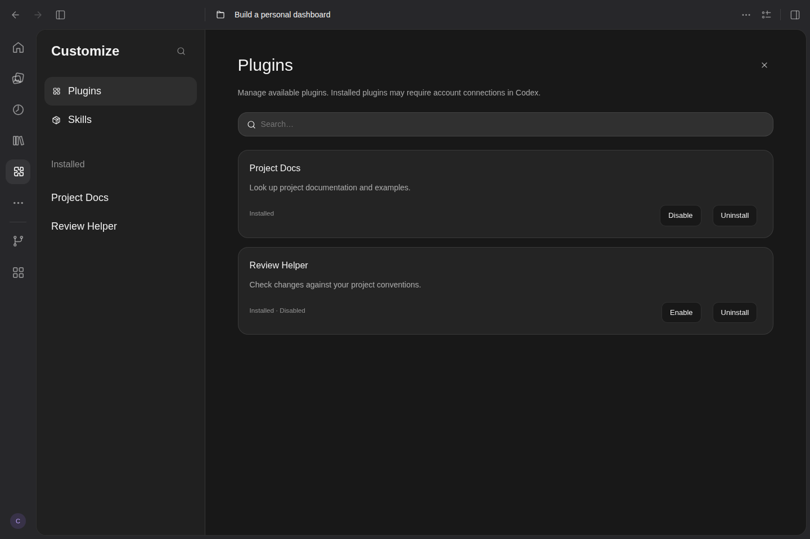

# Codex Remote Web

[English](README.md) | **简体中文**

**把本机 Codex 工作区连接到公网，在电脑、平板和手机上继续开发。**

使用 **Cloudflare Tunnel + Access** 的自托管浏览器工作区：通过网页配置远程访问，在其他设备上继续会话、查看工具进度、处理审批和编辑项目文件。

## 项目亮点

- **公网接入，全程网页配置。** 连接 Cloudflare 账户、选择域名与 Tunnel、指定允许登录的邮箱，预览后部署；无需直接暴露 WebUI 端口。
- **没有域名也能用。** 启动受邮箱验证码保护的临时 HTTPS 地址，复制链接或扫码访问，无需 Cloudflare 账户或 API Token。
- **跨设备继续工作。** 桌面、平板和手机布局，中英文界面、深浅主题、可调整大小的双侧栏和右面板最大化。
- **连接原生 Codex。** 优先接入 Desktop/CLI 的共享 App Server，继续同一会话；支持流式输出、运行进度、审批、原生临时 Side chat 和 Fork。
- **浏览器里的开发工具。** 文件树、语法高亮、代码编辑、Markdown 预览编辑、附件、插件与技能管理，以及项目指令和工作树管理。
- **发送有反馈，排队可恢复。** 支持运行中追加指令或排队，服务端持久队列、多页面同步和提交结果核对；结果不明时暂停，避免自动重复执行。

## 页面预览

以下为当前 WebUI 的实际页面截图，使用隔离的演示项目和模拟会话数据，展示界面与布局；不是模型执行或真实 Cloudflare 部署的结果。

**桌面工作区 · 会话、项目导航与模型/权限选择**



<table>
  <tr>
    <td width="50%"><strong>Files · 文件树、语法高亮与代码编辑</strong></td>
    <td width="50%"><strong>Cloudflare · 公网接入配置预览</strong></td>
  </tr>
  <tr>
    <td></td>
    <td></td>
  </tr>
</table>

<table>
  <tr>
    <td width="35%"><strong>手机 · 随时继续会话</strong></td>
    <td width="65%"><strong>平板 · 更宽的阅读与操作空间</strong></td>
  </tr>
  <tr>
    <td align="center"></td>
    <td align="center"></td>
  </tr>
</table>

<details>
<summary>查看 Customize 插件与技能管理界面</summary>



</details>

## 快速开始

### 下载可执行包（推荐）

从 [Releases](https://github.com/danvilig/codex-remote-web/releases) 下载对应 Linux 架构的归档和同名 `.sha256` 文件：x86_64 选择 `linux-x64`，aarch64 选择 `linux-arm64`。包内包含可执行程序、Bun/Node 运行时、网页资源和预编译终端模块，**无需另外安装 Bun、Node 或编译依赖**。请保留解压后的完整目录。需要自行配置 Codex CLI 和 Git；公网访问还需要 cloudflared。原生系统使用 glibc（原生验收环境为 Ubuntu 24.04），不支持 32 位 ARM 或 Alpine/musl。

```sh
archive=codex-remote-web-0.2.0-alpha.2-linux-x64.tar.gz
# arm64 改为 codex-remote-web-0.2.0-alpha.2-linux-arm64.tar.gz
sha256sum -c "$archive.sha256"
tar -xzf "$archive"
cd codex-remote-web-0.2.0-alpha.2
CODEX_WEBUI_CWD=/path/to/your/project ./codex-remote-web
```

访问 `http://127.0.0.1:8899` 打开完整 WebUI，再进入设置 → Remote access 配置公网。`./codex-remote-web setup` 只打开独立配置向导；支持 `--help` 和 `--version`。

### 从源码或部署归档运行

需要 Bun **1.4.4**、Node.js **24.22.2**、Git 和已配置的 Codex CLI。当前验证协议版本为 Codex **0.164.0**。Linux 原生依赖还需要 C/C++ 构建工具和 Python 3。

Release 的 `deployment-linux-*` 归档包含已构建的 JS/静态资源和冻结锁文件，在目标机器安装生产依赖后运行 `bun run start`。GitHub 自动提供的 Source code 下载包含源码，需要执行以下构建。

```sh
bun install --frozen-lockfile
cp .env.example .env
# 编辑工作目录；沿用你自己的 Codex 配置和凭据。
bun run dev
```

访问 `http://127.0.0.1:8899`。`bun run start` 运行源码服务；生产使用 `bun run build` 后的 `bun run start:production`。程序资源根据安装位置定位，与启动命令所在目录无关。

与 Codex Desktop/CLI 同时使用时，WebUI 优先连接已有的本机共享 App Server。推荐显式设置 `CODEX_WEBUI_APP_SERVER_MODE=shared`；未运行共享服务时默认兼容独立模式，两个独立进程不能同时写同一会话。参见[共享服务配置](docs/CONFIGURATION.md#与-codex-desktop--cli-共享会话)。

## 配置公网访问

在完整本地 WebUI 打开 **设置 → 远程访问**，根据是否拥有域名选择入口：

| 方式 | 固定域名访问 | 无域名临时访问 |
| --- | --- | --- |
| 地址 | 自己的域名或子域名 | 自动分配的临时 HTTPS 地址 |
| 登录保护 | Cloudflare Access，指定唯一邮箱 | 邮件验证码，指定唯一邮箱 |
| 前置条件 | Cloudflare 账户、已托管域名、API Token、cloudflared、Linux 用户级 systemd | 支持 `--allowed-mail` 的 cloudflared；可执行包已内置 Node.js |
| 配置入口 | 开始配置 → 选择 Tunnel 与域名 → 预览 → 应用 | 无域名临时访问 → 填写邮箱 → 启动 |
| 生命周期 | 原生用户服务，支持配置管理 | 随 WebUI 进程及连接器运行；停止后需重新生成地址 |

固定域名向导支持识别本机连接器、复用或新建 Tunnel、子域名及根域名 `@` 输入，以及后续域名、Tunnel 和邮箱调整。默认部署到独立的 `127.0.0.1:8900` 原生服务，保留开发入口。

也可以仅启动配置网页，不启动 Codex App Server：

```sh
bun run setup:cloudflare
```

终端会输出带一次性凭证的本地链接。API Token 权限按 `Account → 权限组 → 级别` 和 `Zone → 权限组 → 级别` 三段式填写；完整步骤见[网页向导说明](docs/deployment/SETUP.md)。

## 工作区能力

| 模块 | 支持的操作 |
| --- | --- |
| 会话与运行 | 项目分组、置顶、搜索、通知排序，实时工具过程、运行状态、加载反馈、计划、审批与用户问题卡片 |
| 发送与队列 | 发送中反馈、steering/排队选择、持久回执、后台队列、编辑/重排/取消/暂停，多页面版本同步与断线核对 |
| Files | 跟随会话项目目录，按需展开文件树、搜索、相对路径、语法高亮、代码保存与冲突保护；Markdown 支持预览中按段落编辑及全文源码编辑 |
| 附件与图片 | 文件/文件夹上传、粘贴、拖放及服务器文件引用；Library 展示上传与会话分享的附件，Images 展示本机及上传图片 |
| Side chat | 原生临时分支，共用输入框样式，独立模型/推理/权限、附件与审批；可显式保存上下文到普通聊天 |
| Customize | 插件/技能启停、安装与卸载，可信本机技能目录安装 |
| Scheduled | 服务器后台单次/固定间隔任务，审批等待、暂停/停止与持久运行记录 |
| 项目工具 | 项目 AGENTS.md 编辑和预览、只读继承范围、托管工作树创建/移除、存储占比及受限清理预览 |
| 设置与连接 | 中英文、深浅主题、模型/推理偏好、受限原生配置、只读 MCP 状态/工具/资源清单，WebSocket 与 SSE 降级 |

## 部署与使用边界

Linux 原生服务为主要部署方式，支持 x86_64（x64）和 aarch64（arm64）；Docker 为备用。容器内不能通过向导配置宿主机 systemd；默认镜像不包含 Codex 或 cloudflared。macOS 暂未完成发布支持。

默认仅监听 loopback，公网通过受保护的 Tunnel 接入。Access 身份验证与 Codex 命令审批、Linux 权限和沙箱分别生效。

Sites 部署、图片生成、云端 Library、插件账户 OAuth 和完整 MCP 交互保留在后续路线图。更多限制见[发布说明](docs/releases/0.2.0-alpha.2.md#已知限制)。

## 文档与开发

- [配置参考](docs/CONFIGURATION.md) / [Cloudflare 部署](docs/deployment/CLOUDFLARE.md)
- [开发与测试](DEVELOPMENT.md) / [贡献指南](CONTRIBUTING.md)
- [架构](docs/ARCHITECTURE.md) / [路线图](docs/ROADMAP.md)
- [发布流程](docs/RELEASING.md) / [验收报告](docs/releases/0.2.0-alpha.2-acceptance.md) / [变更记录](CHANGELOG.md)
- [贡献规范](CONTRIBUTING.md) / [Git 开发流程](docs/GIT_WORKFLOW.md) / [AI agent 规则](AGENTS.md)
- [安全说明](SECURITY.md)

## 参考与致谢

本项目参考 [lezi-fun/codex-webui](https://github.com/lezi-fun/codex-webui) 的 MIT 许可代码与早期 WebUI 形态，当前独立维护；围绕 Cloudflare 公网接入重新设计认证、部署向导、状态协调与浏览器工作区。历史代码来源与许可署名予以保留，详见 [LICENSE](LICENSE) 和[第三方声明](THIRD_PARTY_NOTICES.md)。
