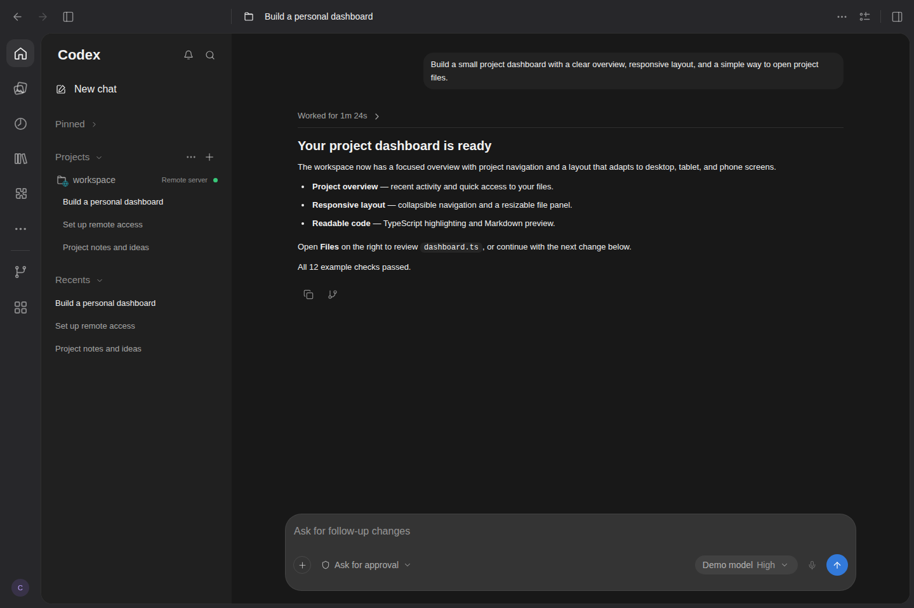
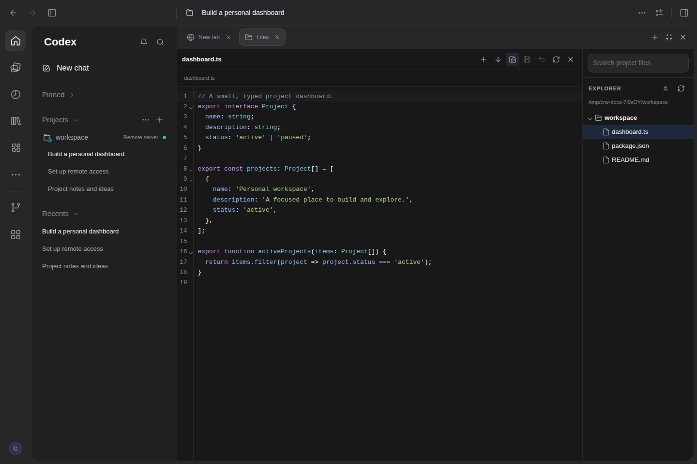
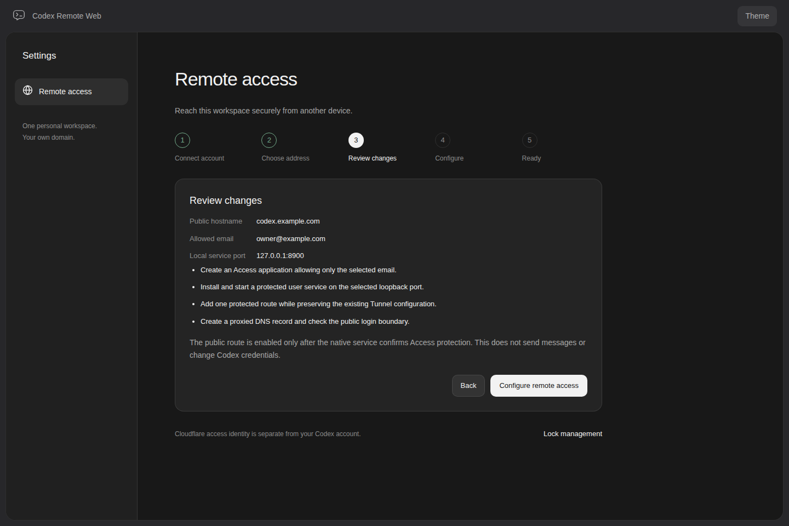
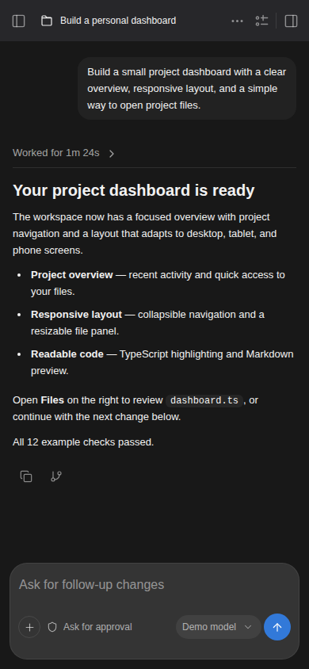
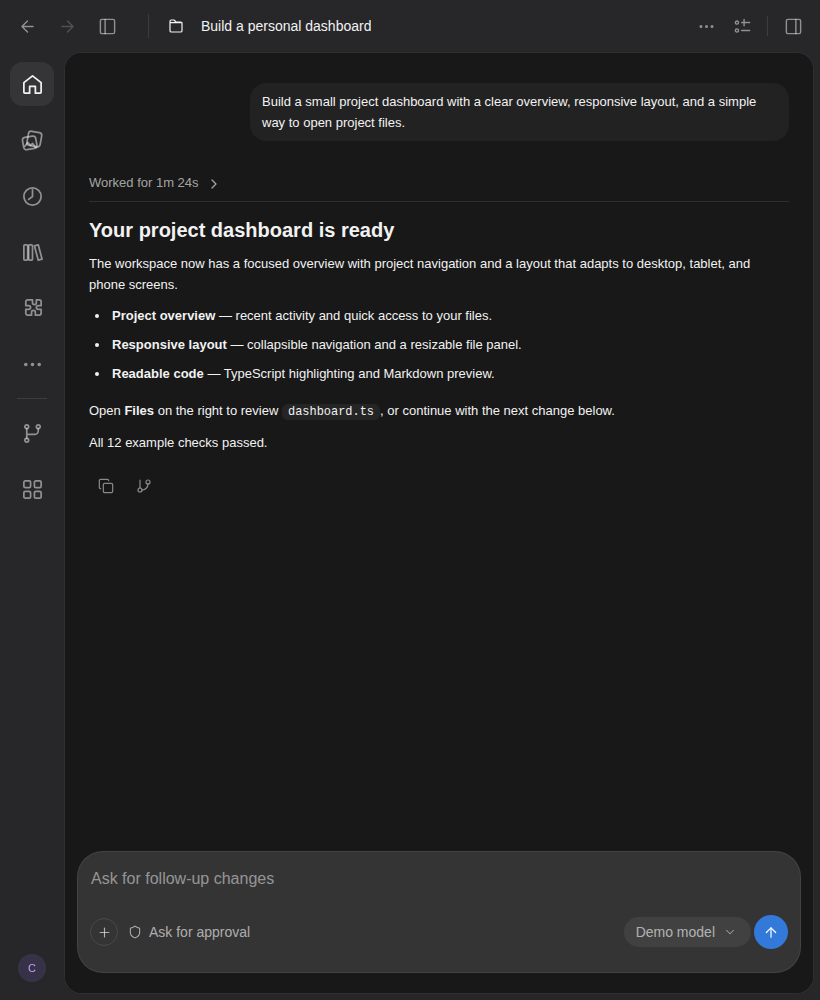
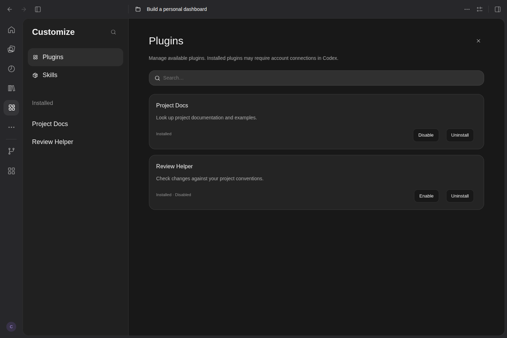

# Codex Remote Web

**English** | [简体中文](README-zh.md)

**Bring your local Codex workspace online. Keep building from your computer, tablet, or phone.**

A self-hosted browser workspace using **Cloudflare Tunnel + Access**. Set up remote access through the web UI, then continue conversations, follow tool activity, handle approvals, and edit project files from another device.

## Highlights

- **Public access, configured in your browser.** Connect your Cloudflare account, choose a domain and Tunnel, specify the allowed email address, then preview and deploy. No need to expose the WebUI port directly.
- **No domain required.** Start a temporary HTTPS address protected by an email verification code. Copy the link or scan its QR code; no Cloudflare account or API Token required.
- **Work across devices.** Desktop, tablet, and phone layouts; English and Chinese; light and dark themes; resizable sidebars and a maximizable right panel.
- **Connect to native Codex.** Prefer the shared Desktop/CLI App Server to continue the same conversation, with streaming responses, tool progress, approvals, native temporary Side chat, and Fork.
- **Development tools in your browser.** A file tree, syntax highlighting, code editing, Markdown preview editing, attachments, plugin and skill management, project instructions, and Git worktrees.
- **Clear sending feedback and recoverable queues.** Steer a running task or queue a message, with a persistent server queue, synchronization across tabs, and submission reconciliation. Uncertain results pause instead of being retried automatically.

## Preview

These screenshots show the current WebUI using an isolated demo project and simulated conversation data. They illustrate the interface and layout, rather than actual model execution or a live Cloudflare deployment.

**Desktop workspace · Conversations, project navigation, and model/permission controls**



<table>
  <tr>
    <td width="50%"><strong>Files · File tree, syntax highlighting, and code editing</strong></td>
    <td width="50%"><strong>Cloudflare · Public access configuration preview</strong></td>
  </tr>
  <tr>
    <td></td>
    <td></td>
  </tr>
</table>

<table>
  <tr>
    <td width="35%"><strong>Phone · Continue conversations on the go</strong></td>
    <td width="65%"><strong>Tablet · More room to read and work</strong></td>
  </tr>
  <tr>
    <td align="center"></td>
    <td align="center"></td>
  </tr>
</table>

<details>
<summary>View Customize plugin and skill management</summary>



</details>

## Quick start

Requires Bun **1.4.4**, Node.js **24.22.2**, Git, and a configured Codex CLI. The currently tested Codex protocol version is **0.164.0**. Native Linux dependencies also require C/C++ build tools and Python 3.

```sh
bun install --frozen-lockfile
cp .env.example .env
# Set your working directory; keep using your own Codex configuration and credentials.
bun run dev
```

Open `http://127.0.0.1:8899`. `bun run start` runs the source server; for production, run `bun run build` followed by `bun run start:production`. Application resources resolve relative to the installation, independently of the directory you launch from.

When used alongside Codex Desktop/CLI, the WebUI prefers an existing local shared App Server. Explicitly setting `CODEX_WEBUI_APP_SERVER_MODE=shared` is recommended. Without a shared service, the default mode supports an isolated process; two isolated processes cannot write to the same conversation simultaneously. See [shared server configuration](docs/CONFIGURATION.md#与-codex-desktop--cli-共享会话).

## Set up public access

In the full local WebUI, open **Settings → Remote access** and choose an option based on whether you own a domain:

| | Fixed domain | Temporary access without a domain |
| --- | --- | --- |
| Address | Your own domain or subdomain | An automatically assigned temporary HTTPS address |
| Login protection | Cloudflare Access, restricted to one email address | Email verification code, restricted to one email address |
| Requirements | Cloudflare account, a domain hosted on Cloudflare, API Token, cloudflared, and Linux user-level systemd | cloudflared with `--allowed-mail` support and Node.js |
| Setup | Start setup → Choose Tunnel and domain → Preview → Apply | Temporary access → Enter email → Start |
| Lifecycle | Native user service with configuration management | Runs with the WebUI process and connector; generate a new address after stopping |

The fixed-domain wizard can identify local connectors, reuse or create a Tunnel, accept a subdomain or `@` for the root domain, and later change the domain, Tunnel, or allowed email. By default, it deploys a separate native service at `127.0.0.1:8900`, keeping the development entry point available.

You can also launch only the setup page, without starting a Codex App Server:

```sh
bun run setup:cloudflare
```

The terminal prints a local link with a one-time credential. API Token permissions follow Cloudflare's three-part format: `Account → Permission group → Level` and `Zone → Permission group → Level`. See the [web setup guide](docs/deployment/SETUP.md) for full instructions.

## Workspace features

| Module | Supported operations |
| --- | --- |
| Conversations and activity | Project groups, pinning, search, notification ordering, live tool activity, running and loading states, plans, approvals, and user question cards |
| Sending and queues | Sending feedback, steering or queueing, persistent receipts, background queues, editing/reordering/canceling/pausing, version synchronization across tabs, and reconciliation after disconnection |
| Files | Follows the conversation's project directory; on-demand file tree, search, relative paths, syntax highlighting, saving, and conflict protection; Markdown supports editing blocks in preview and full-source editing |
| Attachments and images | File/folder uploads, paste, drag and drop, and server file references; Library shows uploaded and conversation-shared attachments, while Images shows local and uploaded images |
| Side chat | Native temporary branches with matching composer styling, independent model/reasoning/permissions, attachments, and approvals; explicitly save context to a regular conversation |
| Customize | Enable, disable, install, and uninstall plugins/skills; install skills from trusted local directories |
| Scheduled | Server-side one-time or recurring tasks, approval waiting, pause/stop controls, and persistent run history |
| Project tools | Edit and preview project AGENTS.md files, view inherited instructions, create/remove managed worktrees, visualize storage usage, and preview restricted cleanup |
| Settings and connections | English/Chinese, light/dark themes, model/reasoning preferences, restricted native configuration, read-only MCP status/tool/resource lists, and WebSocket with SSE fallback |

## Deployment and scope

Native Linux services are the primary deployment method; Docker is an alternative. The wizard cannot configure host systemd from inside a container. The default image includes neither Codex nor cloudflared. macOS release support has not yet been validated.

The server listens on loopback by default, with public access through a protected Tunnel. Access authentication operates separately from Codex command approvals, Linux permissions, and sandboxing.

Sites deployment, image generation, cloud Library, plugin account OAuth, and full MCP interactions remain on the roadmap. See the [release notes](docs/releases/0.2.0-alpha.2.md#已知限制) for more limitations.

## Documentation and development

The detailed guides below are currently in Chinese.

- [Configuration](docs/CONFIGURATION.md) / [Cloudflare deployment](docs/deployment/CLOUDFLARE.md)
- [Development and testing](DEVELOPMENT.md) / [Contributing](CONTRIBUTING.md)
- [Architecture](docs/ARCHITECTURE.md) / [Roadmap](docs/ROADMAP.md)
- [Release process](docs/RELEASING.md) / [Acceptance report](docs/releases/0.2.0-alpha.2-acceptance.md) / [Changelog](CHANGELOG.md)
- [Security](SECURITY.md)

## References and acknowledgements

This independently maintained project references the MIT-licensed code and early WebUI design of [lezi-fun/codex-webui](https://github.com/lezi-fun/codex-webui). Authentication, deployment setup, state coordination, and the browser workspace have been redesigned around public access through Cloudflare. Historical code attribution and license notices are preserved; see [LICENSE](LICENSE) and [third-party notices](THIRD_PARTY_NOTICES.md).
