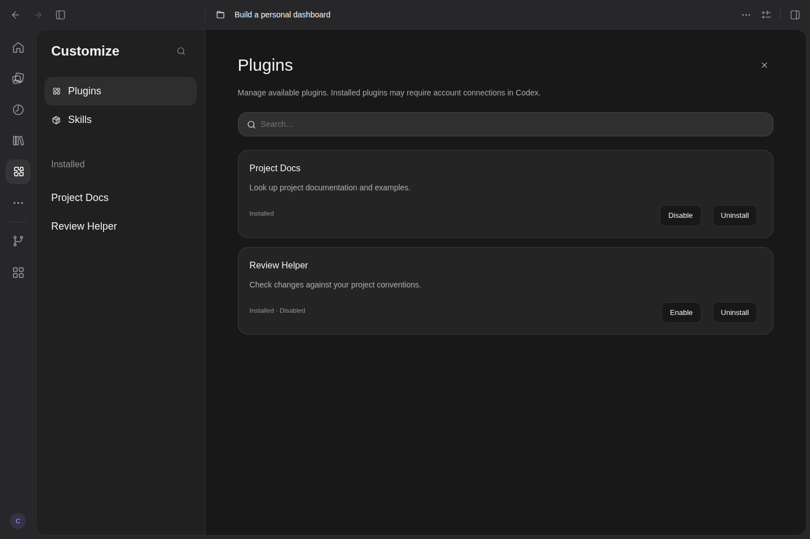

# Codex Remote Web

**English** | [简体中文](README-zh.md)

**Bring your local Codex workspace online. Keep building from your computer, tablet, or phone.**

A self-hosted browser workspace using **Cloudflare Tunnel + Access**. Set up remote access through the web UI, then continue conversations, follow tool activity, handle approvals, and edit project files from another device.

> **Beta.2 candidate:** This branch prepares **0.2.0-beta.2** with a lightweight native gateway. See the [Beta.2 release notes](docs/releases/0.2.0-beta.2.md).

## Highlights

- **Public access, configured in your browser.** Connect your Cloudflare account, choose a domain and Tunnel, specify the allowed email address, then preview and deploy. No need to expose the WebUI port directly.
- **No domain required.** Start a temporary HTTPS address protected by an email verification code. Copy the link or scan its QR code; no Cloudflare account or API Token required.
- **A desktop gateway with browser access.** Initialize and control the background gateway from a tray/settings app on macOS, Windows and Linux. Desktop and Web settings share themes, controls and motion that respects reduced-motion preferences.
- **Work across devices.** Desktop, tablet, and phone layouts; English and Chinese; light and dark themes; resizable sidebars and a maximizable right panel.
- **Connect to native Codex.** Join the shared Desktop/CLI App Server to continue the same conversation, with streaming responses, tool progress, approvals, native temporary Side chat, and Fork.
- **Development tools in your browser.** A file tree, syntax highlighting, code editing, Markdown preview editing, attachments, plugin and skill management, project instructions, and Git worktrees.
- **Clear sending feedback and recoverable queues.** Steer a running task or queue a message, with a persistent server queue, synchronization across tabs, and submission reconciliation. Uncertain results pause instead of being retried automatically.

## Preview

These screenshots show the current WebUI using an isolated demo project and simulated conversation data. They illustrate the interface and layout, rather than actual model execution or a live Cloudflare deployment.

**Desktop workspace · Conversations, project navigation, and model/permission controls**


<table>
  <tr>
    <td width="50%"><strong>Files · File tree, syntax highlighting, and code editing</strong></td>
    <td width="50%"><strong>Cloudflare · Public access configuration preview</strong></td>
  </tr>
  <tr>
    <td></td>
    <td></td>
  </tr>
</table>

<table>
  <tr>
    <td width="35%"><strong>Phone · Continue conversations on the go</strong></td>
    <td width="65%"><strong>Tablet · More room to read and work</strong></td>
  </tr>
  <tr>
    <td align="center"></td>
    <td align="center"></td>
  </tr>
</table>

<details>
<summary>View Customize plugin and skill management</summary>



</details>

## Desktop gateway

The macOS DMG, Windows MSI and Linux desktop DEB provide the same initialization/settings window, background gateway controls, login startup, remote access and diagnostics. Closing the window or quitting the tray leaves the gateway running until logout, without a terminal. Portable CLI packages remain available for headless use. See [desktop platform setup](docs/deployment/PLATFORMS.md).

## Quick start

### Download desktop installers or portable packages (recommended)

Download your package and its `.sha256` from [Releases](https://github.com/danvilig/codex-remote-web/releases). The packages use a lightweight native gateway with a built-in terminal. **No separate gateway runtime installation or compilation is required.** Keep the extracted directory intact. Install and configure Codex CLI and Git separately; remote access also requires cloudflared.

| Platform | Package | Requirements |
| --- | --- | --- |
| Linux x64 / arm64 | `desktop-linux-x64.deb` / `desktop-linux-arm64.deb` (desktop); `linux-x64.tar.gz` / `linux-arm64.tar.gz` (CLI) | glibc; desktop baseline: Ubuntu 24.04 GNOME |
| macOS Apple Silicon | `macos-arm64.dmg` (installer) / `.tar.gz` (portable) | macOS 15 or newer; Intel Macs are not supported |
| Windows x64 | `windows-x64.msi` (installer) / `.zip` (portable) | Windows 11, NTFS, Windows PowerShell; ARM64 is not supported |

### Desktop installers: initialize once, then use the tray

On macOS, drag **Codex Remote Web.app** from the DMG into Applications and open it. On Windows, install the per-user MSI and launch **Codex Remote Web** from the Start menu. On Ubuntu, install the desktop DEB and open the application from the app launcher.

1. In **Gateway settings**, choose a project directory and port (default `8899`). Select Codex/cloudflared executable paths if they are not found automatically, check dependencies and save. The app uses your existing Codex account and configuration.
2. In **Overview**, start the gateway and open the browser workspace. The settings window offers start, stop and restart; the tray menu offers start and stop.
3. For access from another device, open **Remote access** and choose a fixed domain or a temporary address protected by an email code.

Closing settings hides the window to the tray; quitting the tray leaves the background gateway running. On Linux desktops without tray support, closing settings minimizes the window to the taskbar. Use **Stop gateway** to stop the gateway and its managed connections; logging out ends the background session. **Start gateway at login** is checked by default and registered when you first save settings; uncheck it before saving if you do not want automatic startup. Disabling it later does not stop the current gateway. The browser terminal is off by default.

Stop the gateway before upgrading. Windows supports uninstalling from **Installed apps**, and Linux supports removing the DEB. Before deleting the macOS app, use **Diagnostics → Stop and remove background component**. Projects and Codex credentials are retained; removing a managed Cloudflare deployment is a separate action in Remote access. See [desktop platform setup](docs/deployment/PLATFORMS.md).

Desktop packages are unsigned. Review the checksum and source, and use your system's per-file approval only for a download you trust. Never disable Gatekeeper or SmartScreen globally. Linux 32-bit ARM and Alpine/musl are not supported.

### Portable CLI packages

The following examples target **0.2.0-beta.2** portable packages. Use the package name and version matching your download; candidate builds are available as CI artifacts until the release is published. They run in a terminal; close it or press Ctrl+C to stop the gateway.
```sh
archive=codex-remote-web-0.2.0-beta.2-linux-x64.tar.gz
# For arm64 use codex-remote-web-0.2.0-beta.2-linux-arm64.tar.gz
sha256sum -c "$archive.sha256"
tar -xzf "$archive"
cd codex-remote-web-0.2.0-beta.2
CODEX_WEBUI_CWD=/path/to/your/project ./codex-remote-web
```

On macOS, extract the `macos-arm64` archive and run the same command. On Windows, extract the zip, open PowerShell in its folder, and run:

```powershell
# Compare with the hash in the adjacent .sha256 file before extracting.
Get-FileHash .\codex-remote-web-0.2.0-beta.2-windows-x64.zip -Algorithm SHA256
$env:CODEX_WEBUI_CWD = 'C:\path\to\your\project'
.\codex-remote-web.exe
```

Open `http://127.0.0.1:8899` for the full WebUI. Use Settings → Remote access for public access; `./codex-remote-web setup` opens only the standalone setup wizard. `--help` and `--version` are available.

### Run from source or a deployment archive

Requires Bun **1.4.4**, Node.js **24.22.2**, Git, and a configured Codex CLI. The currently tested Codex protocol version is **0.164.0**. Native Linux dependencies also require C/C++ build tools and Python 3.

The `deployment-linux-*` Release archives contain prebuilt JS/static assets with a frozen dependency lockfile; install production dependencies on the target machine and run `bun run start`. GitHub's Source code downloads contain the source tree and require the build below.

```sh
bun install --frozen-lockfile
cp .env.example .env
# Set your working directory; keep using your own Codex configuration and credentials.
bun run dev
```

Open `http://127.0.0.1:8899`. `bun run start` runs the source server; for production, run `bun run build` followed by `bun run start:production`. Application resources resolve relative to the installation, independently of the directory you launch from.

The WebUI defaults to the local shared Desktop/CLI App Server and waits if its socket is not ready. Legacy `auto` mode also waits; it never starts a second writer based on startup order. Start the native daemon before use, or explicitly set `CODEX_WEBUI_APP_SERVER_MODE=isolated` for a standalone deployment. Two isolated processes cannot write the same conversation simultaneously. See [shared server configuration](docs/CONFIGURATION.md#与-codex-desktop--cli-共享会话).

## Set up public access

For a desktop-managed gateway, open **Remote access** in the desktop app; its browser settings show deployment status and direct management back to the app. For a CLI/headless gateway, open **Settings → Remote access** in the full local WebUI. Initialize and start the local gateway first, then choose an option based on whether you own a domain:

| | Fixed domain | Temporary access without a domain |
| --- | --- | --- |
| Address | Your own domain or subdomain | An automatically assigned temporary HTTPS address |
| Login protection | Cloudflare Access, restricted to one email address | Email verification code, restricted to one email address |
| Requirements | Cloudflare account, a domain hosted on Cloudflare, API Token and cloudflared; managed by the desktop app or Linux user-level systemd | cloudflared with `--allowed-mail` support |
| Setup | Start setup → Choose Tunnel and domain → Preview → Apply | Temporary access → Enter email → Start |
| Lifecycle | Desktop-managed background gateway/connector or a Linux user service | Runs with the gateway and connector; generate a new address after stopping |

The fixed-domain wizard can identify local connectors, reuse or create a Tunnel, accept a subdomain or `@` for the root domain, and later change the domain, Tunnel, or allowed email. By default, it uses a separate protected gateway at `127.0.0.1:8900`, keeping the local workspace available. The desktop app manages this gateway and its connector on macOS/Windows/Linux; headless automatic service deployment uses Linux user-level systemd.

New fixed-domain Access applications use a **30-day (`720h`) application session** with an HttpOnly, SameSite=Lax cookie. Existing applications are not changed by upgrading WebUI. Administrators must adjust their cloud-side settings separately if desired; shorter policy/global/client sessions, revocation, logout or cookie clearing can require an earlier sign-in. This does not change temporary-address email-code authentication. See [Access session migration](docs/deployment/CLOUDFLARE.md).

You can also launch only the setup page, without starting a Codex App Server:

```sh
bun run setup:cloudflare
```

The terminal prints a local link with a one-time credential. API Token permissions follow Cloudflare's three-part format: `Account → Permission group → Level` and `Zone → Permission group → Level`. See the [web setup guide](docs/deployment/SETUP.md) for full instructions.

## Workspace features

| Module | Supported operations |
| --- | --- |
| Conversations and activity | Project groups, pinning, search, notification ordering, live tool activity, running and loading states, plans, approvals, and user question cards |
| Sending and queues | Sending feedback, steering or queueing, persistent receipts, background queues, editing/reordering/canceling/pausing, version synchronization across tabs, and reconciliation after disconnection |
| Files | Follows the conversation's project directory; on-demand file tree, search, relative paths, syntax highlighting, saving, and conflict protection; Markdown supports editing blocks in preview and full-source editing |
| Attachments and images | File/folder uploads, paste, drag and drop, and server file references; Library shows uploaded and conversation-shared attachments, while Images shows local and uploaded images |
| Side chat | Native temporary branches with matching composer styling, independent model/reasoning/permissions, attachments, and approvals; explicitly save context to a regular conversation |
| Customize | Enable, disable, install, and uninstall plugins/skills; install skills from trusted local directories |
| Scheduled | Server-side one-time or recurring tasks, approval waiting, pause/stop controls, and persistent run history |
| Project tools | Edit and preview project AGENTS.md files, view inherited instructions, create/remove managed worktrees, visualize storage usage, and preview restricted cleanup |
| Settings and connections | English/Chinese, light/dark themes, model/reasoning preferences, restricted native configuration, read-only MCP status/tool/resource lists, and WebSocket with SSE fallback |

## Deployment and scope

For desktop use, choose the macOS/Windows installer or Linux desktop DEB. For servers, use a headless Linux package or Docker. Desktop background processes run as the logged-in user; use a server deployment if the workspace must remain online after logout. The desktop app does not automatically take over an existing headless/systemd deployment: stop conflicting gateways before switching.

Desktop-managed fixed-domain setup and protected temporary access support macOS, Windows and Linux. Headless automatic service deployment requires Linux user-level systemd; the wizard cannot configure host systemd from inside a container. The default Docker image includes neither Codex nor cloudflared. See [platform setup](docs/deployment/PLATFORMS.md).

The server listens on loopback by default, with public access through a protected Tunnel. Access authentication operates separately from Codex command approvals, Linux permissions, and sandboxing.

Sites deployment, image generation, cloud Library, plugin account OAuth, and full MCP interactions remain on the roadmap. See the [release notes](docs/releases/0.2.0-beta.1.md) for more limitations.

### Shared Codex sessions and standalone deployments

Desktop installations reuse the local Codex daemon and ask the configured Codex CLI to start it if it is missing. Standalone shared deployments and desktop installations with an explicit connection override wait for the configured daemon. WebUI reconnects without replaying execution requests, and stopping the gateway does not stop the shared daemon or its tasks. Docker and Compose explicitly select `isolated` mode. Before upgrading an existing isolated deployment, inspect tasks, approvals and queues, then restart its gateway to switch connection modes; refreshing the browser is insufficient.

## Documentation and development

The detailed guides below are currently in Chinese.

- [Configuration](docs/CONFIGURATION.md) / [Cloudflare deployment](docs/deployment/CLOUDFLARE.md)
- [Development and testing](DEVELOPMENT.md) / [Contributing](CONTRIBUTING.md)
- [Architecture](docs/ARCHITECTURE.md) / [Roadmap](docs/ROADMAP.md)
- [Release process](docs/RELEASING.md) / [Candidate verification](docs/releases/0.2.0-beta.2-acceptance.md) / [Changelog](CHANGELOG.md)
- [Contributing](CONTRIBUTING.md) / [Git workflow](docs/GIT_WORKFLOW.md) / [Agent rules](AGENTS.md)
- [Security](SECURITY.md)

## References and acknowledgements

This independently maintained project references the MIT-licensed code and early WebUI design of [lezi-fun/codex-webui](https://github.com/lezi-fun/codex-webui). Authentication, deployment setup, state coordination, and the browser workspace have been redesigned around public access through Cloudflare. Historical code attribution and license notices are preserved; see [LICENSE](LICENSE) and [third-party notices](THIRD_PARTY_NOTICES.md).
