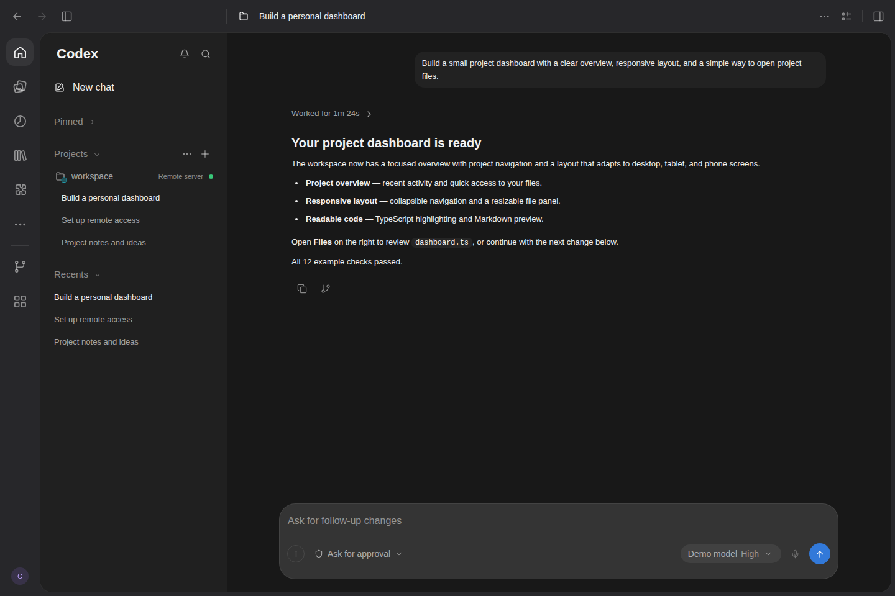
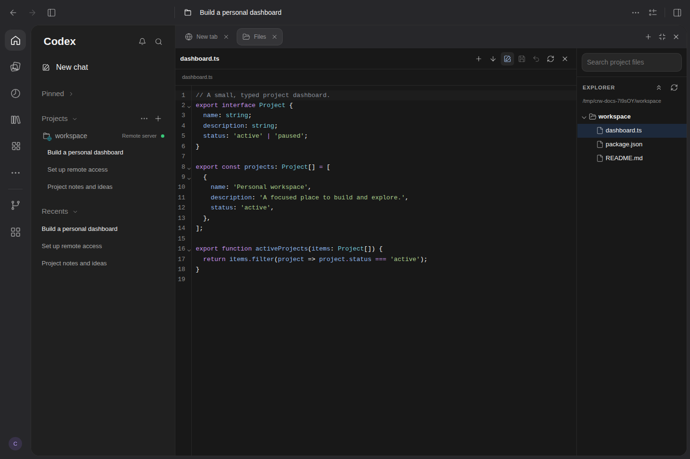
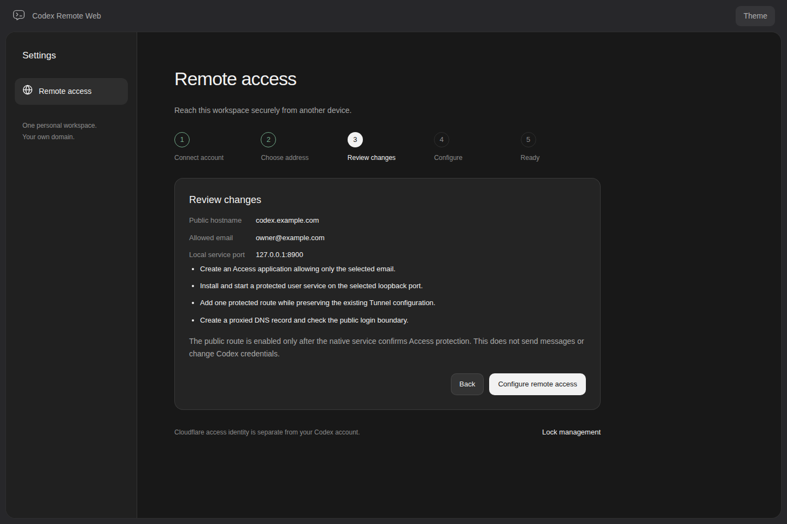
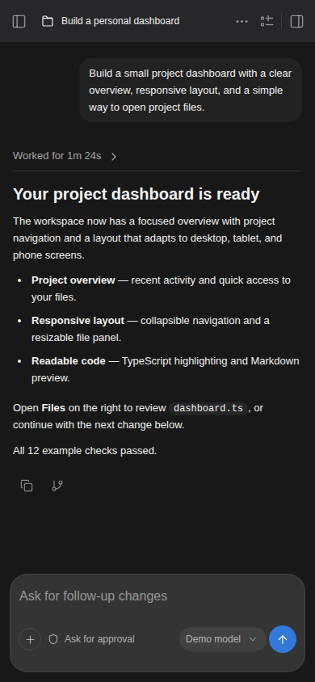
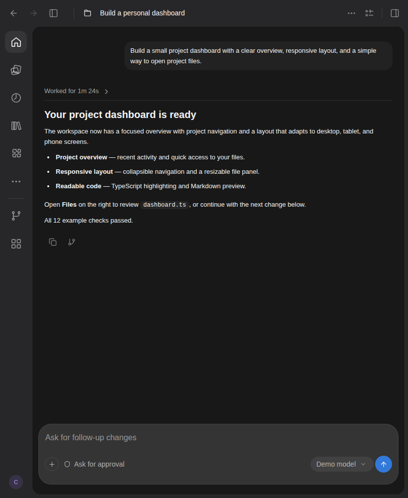

# Codex Remote Web

**English** | [简体中文](README-zh.md)

**Bring your local Codex workspace online. Keep building from your computer, tablet, or phone.**

A self-hosted browser workspace using **Cloudflare Tunnel + Access**. Set up remote access through the web UI, then continue conversations, follow tool activity, handle approvals, and edit project files from another device.

## Highlights

- **Public access, configured in your browser.** Connect your Cloudflare account, choose a domain and Tunnel, specify the allowed email address, then preview and deploy. No need to expose the WebUI port directly.
- **No domain required.** Start a temporary HTTPS address protected by an email verification code. Copy the link or scan its QR code; no Cloudflare account or API Token required.
- **Work across devices.** Desktop, tablet, and phone layouts; English and Chinese; light and dark themes; resizable sidebars and a maximizable right panel.
- **Connect to native Codex.** Join the shared Desktop/CLI App Server to continue the same conversation, with streaming responses, tool progress, approvals, native temporary Side chat, and Fork.
- **Development tools in your browser.** A file tree, syntax highlighting, code editing, Markdown preview editing, attachments, plugin and skill management, project instructions, and Git worktrees.
- **Clear sending feedback and recoverable queues.** Steer a running task or queue a message, with a persistent server queue, synchronization across tabs, and submission reconciliation. Uncertain results pause instead of being retried automatically.

## Preview

These screenshots show the current WebUI using an isolated demo project and simulated conversation data. They illustrate the interface and layout, rather than actual model execution or a live Cloudflare deployment.

**Desktop workspace · Conversations, project navigation, and model/permission controls**



<table>
  <tr>
    <td width="50%"><strong>Files · File tree, syntax highlighting, and code editing</strong></td>
    <td width="50%"><strong>Cloudflare · Public access configuration preview</strong></td>
  </tr>
  <tr>
    <td></td>
    <td></td>
  </tr>
</table>

<table>
  <tr>
    <td width="35%"><strong>Phone · Continue conversations on the go</strong></td>
    <td width="65%"><strong>Tablet · More room to read and work</strong></td>
  </tr>
  <tr>
    <td align="center"></td>
    <td align="center"></td>
  </tr>
</table>

<details>
<summary>View Customize plugin and skill management</summary>


</details>

## Desktop gateway

The macOS DMG, Windows MSI and Linux desktop DEB provide the same initialization/settings window, background gateway controls, login startup, remote access and diagnostics. Closing the window or quitting the tray leaves the gateway running until logout, without a terminal. Portable CLI packages remain available for headless use. See [desktop platform setup](docs/deployment/PLATFORMS.md).

## Quick start

### Download an installer or executable (recommended)

Download your package and its `.sha256` from [Releases](https://github.com/danvilig/codex-remote-web/releases). Each executable package includes Bun/Node, web assets and the native terminal module; **no runtime installation or compilation is required**. Keep the extracted directory intact. Install and configure Codex CLI and Git separately; remote access also requires cloudflared.

| Platform | Package | Requirements |
| --- | --- | --- |
| Linux x64 / arm64 | `linux-x64.tar.gz` / `linux-arm64.tar.gz` | glibc; validated on Ubuntu 24.04 |
| macOS Apple Silicon | `macos-arm64.dmg` (installer) / `.tar.gz` (portable) | macOS 15 or newer; Intel Macs are not supported |
| Windows x64 | `windows-x64.msi` (installer) / `.zip` (portable) | Windows 11, NTFS, Windows PowerShell; ARM64 is not supported |

For macOS, open the DMG, drag **Codex Remote Web.app** into Applications, and open it to start the gateway in Terminal and open your browser. For Windows, run the per-user MSI and use **Codex Remote Web** / **Open WebUI** in the Start menu; uninstall from Installed apps. Neither installer adds a background service. Close the Terminal/console or press Ctrl+C to stop the gateway. Portable archives remain available. macOS/Windows downloads are unsigned; review the checksum and source, and use your system's per-file approval only for a download you trust. Never disable Gatekeeper or SmartScreen globally. Linux 32-bit ARM and Alpine/musl are not supported.

```sh
archive=codex-remote-web-0.2.0-alpha.3-linux-x64.tar.gz
# For arm64 use codex-remote-web-0.2.0-alpha.3-linux-arm64.tar.gz
sha256sum -c "$archive.sha256"
tar -xzf "$archive"
cd codex-remote-web-0.2.0-alpha.3
CODEX_WEBUI_CWD=/path/to/your/project ./codex-remote-web
```

On macOS, extract the `macos-arm64` archive and run the same command. On Windows, extract the zip, open PowerShell in its folder, and run:

```powershell
# Compare with the hash in the adjacent .sha256 file before extracting.
Get-FileHash .\codex-remote-web-0.2.0-alpha.3-windows-x64.zip -Algorithm SHA256
$env:CODEX_WEBUI_CWD = 'C:\path\to\your\project'
.\codex-remote-web.exe
```

Open `http://127.0.0.1:8899` for the full WebUI. Use Settings → Remote access for public access; `./codex-remote-web setup` opens only the standalone setup wizard. `--help` and `--version` are available.

### Run from source or a deployment archive

Requires Bun **1.4.4**, Node.js **24.22.2**, Git, and a configured Codex CLI. The currently tested Codex protocol version is **0.164.0**. Native Linux dependencies also require C/C++ build tools and Python 3.

The `deployment-linux-*` Release archives contain prebuilt JS/static assets with a frozen dependency lockfile; install production dependencies on the target machine and run `bun run start`. GitHub's Source code downloads contain the source tree and require the build below.

```sh
bun install --frozen-lockfile
cp .env.example .env
# Set your working directory; keep using your own Codex configuration and credentials.
bun run dev
```

Open `http://127.0.0.1:8899`. `bun run start` runs the source server; for production, run `bun run build` followed by `bun run start:production`. Application resources resolve relative to the installation, independently of the directory you launch from.

The WebUI defaults to the local shared Desktop/CLI App Server and waits if its socket is not ready. Legacy `auto` mode also waits; it never starts a second writer based on startup order. Start the native daemon before use, or explicitly set `CODEX_WEBUI_APP_SERVER_MODE=isolated` for a standalone deployment. Two isolated processes cannot write the same conversation simultaneously. See [shared server configuration](docs/CONFIGURATION.md#与-codex-desktop--cli-共享会话).

## Set up public access

In the full local WebUI, open **Settings → Remote access** and choose an option based on whether you own a domain:

| | Fixed domain | Temporary access without a domain |
| --- | --- | --- |
| Address | Your own domain or subdomain | An automatically assigned temporary HTTPS address |
| Login protection | Cloudflare Access, restricted to one email address | Email verification code, restricted to one email address |
| Requirements | Cloudflare account, a domain hosted on Cloudflare, API Token, cloudflared, and Linux user-level systemd | cloudflared with `--allowed-mail` support; Node.js is included in executable packages |
| Setup | Start setup → Choose Tunnel and domain → Preview → Apply | Temporary access → Enter email → Start |
| Lifecycle | Native user service with configuration management | Runs with the WebUI process and connector; generate a new address after stopping |

The fixed-domain wizard can identify local connectors, reuse or create a Tunnel, accept a subdomain or `@` for the root domain, and later change the domain, Tunnel, or allowed email. By default, it deploys a separate native service at `127.0.0.1:8900`, keeping the development entry point available.

You can also launch only the setup page, without starting a Codex App Server:

```sh
bun run setup:cloudflare
```

The terminal prints a local link with a one-time credential. API Token permissions follow Cloudflare's three-part format: `Account → Permission group → Level` and `Zone → Permission group → Level`. See the [web setup guide](docs/deployment/SETUP.md) for full instructions.

## Workspace features

| Module | Supported operations |
| --- | --- |
| Conversations and activity | Project groups, pinning, search, notification ordering, live tool activity, running and loading states, plans, approvals, and user question cards |
| Sending and queues | Sending feedback, steering or queueing, persistent receipts, background queues, editing/reordering/canceling/pausing, version synchronization across tabs, and reconciliation after disconnection |
| Files | Follows the conversation's project directory; on-demand file tree, search, relative paths, syntax highlighting, saving, and conflict protection; Markdown supports editing blocks in preview and full-source editing |
| Attachments and images | File/folder uploads, paste, drag and drop, and server file references; Library shows uploaded and conversation-shared attachments, while Images shows local and uploaded images |
| Side chat | Native temporary branches with matching composer styling, independent model/reasoning/permissions, attachments, and approvals; explicitly save context to a regular conversation |
| Customize | Enable, disable, install, and uninstall plugins/skills; install skills from trusted local directories |
| Scheduled | Server-side one-time or recurring tasks, approval waiting, pause/stop controls, and persistent run history |
| Project tools | Edit and preview project AGENTS.md files, view inherited instructions, create/remove managed worktrees, visualize storage usage, and preview restricted cleanup |
| Settings and connections | English/Chinese, light/dark themes, model/reasoning preferences, restricted native configuration, read-only MCP status/tool/resource lists, and WebSocket with SSE fallback |

## Deployment and scope

Native Linux services are the primary deployment method on x86_64 and arm64; Docker is an alternative. The wizard cannot configure host systemd from inside a container. The default image includes neither Codex nor cloudflared. macOS arm64 and Windows x64 executable packages are also available. The fixed-domain automatic service wizard requires Linux user systemd; on macOS/Windows configure Tunnel + Access manually and use `cloudflare-access` authentication. Protected temporary access is available on Linux/macOS; Windows temporary access is not supported. See [platform setup](docs/deployment/PLATFORMS.md).

The server listens on loopback by default, with public access through a protected Tunnel. Access authentication operates separately from Codex command approvals, Linux permissions, and sandboxing.

Sites deployment, image generation, cloud Library, plugin account OAuth, and full MCP interactions remain on the roadmap. See the [release notes](docs/releases/0.2.0-alpha.3.md) for more limitations.

## Documentation and development

The detailed guides below are currently in Chinese.

- [Configuration](docs/CONFIGURATION.md) / [Cloudflare deployment](docs/deployment/CLOUDFLARE.md)
- [Development and testing](DEVELOPMENT.md) / [Contributing](CONTRIBUTING.md)
- [Architecture](docs/ARCHITECTURE.md) / [Roadmap](docs/ROADMAP.md)
- [Release process](docs/RELEASING.md) / [Acceptance report](docs/releases/0.2.0-alpha.3.md) / [Changelog](CHANGELOG.md)
- [Contributing](CONTRIBUTING.md) / [Git workflow](docs/GIT_WORKFLOW.md) / [Agent rules](AGENTS.md)
- [Security](SECURITY.md)

## References and acknowledgements

This independently maintained project references the MIT-licensed code and early WebUI design of [lezi-fun/codex-webui](https://github.com/lezi-fun/codex-webui). Authentication, deployment setup, state coordination, and the browser workspace have been redesigned around public access through Cloudflare. Historical code attribution and license notices are preserved; see [LICENSE](LICENSE) and [third-party notices](THIRD_PARTY_NOTICES.md).
